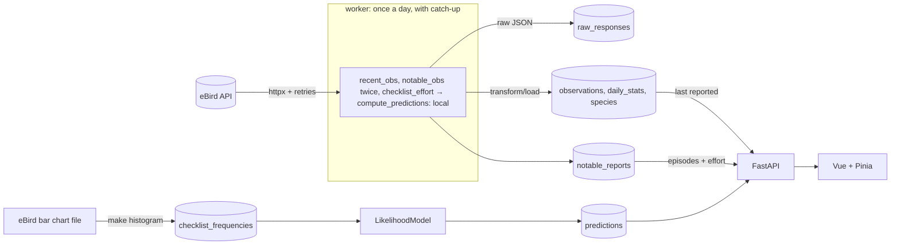

# Field Odds

**Which birds am I likely to see in my county today, and how likely is each one?**

Field Odds pulls data from the [eBird API 2.0](https://documenter.getpostman.com/view/664302/S1ENwy59) on a schedule. It archives the raw responses and runs them through a small ETL pipeline, then computes a daily likelihood for every species reported in a county. A Vue app shows the ranked list.

| Layer    | Tech |
|----------|------|
| API      | Python 3.12, FastAPI, SQLAlchemy 2, Alembic, Pydantic |
| Pipeline | Job registry plus APScheduler worker, httpx with tenacity retries |
| Model    | Per-checklist detection frequency, behind a swappable `LikelihoodModel` interface |
| Frontend | Vue 3, Pinia, Vue Router, TypeScript, Vite |
| Infra    | Docker Compose (Postgres 16, api, worker, nginx), GitHub Actions CI |

## Architecture



- The **worker and API are separate processes.** Jobs contain no scheduling code, so APScheduler can be swapped for Celery beat, Prefect or a cloud cron without touching them.
- **The API is for recent data only, at 4 calls a day:**
  - recent sightings for the last 7 days (6:00)
  - rare and unusual reports for the last 30 days (6:00 and 11:00)
  - the county's checklist count from two days ago (6:00), plus one call per missed day, up to 7
- **Missed pulls catch up.** If the machine was off or asleep, the latest missed slot runs at the next chance. A failed pull gets at most 3 attempts per slot, an hour apart.
- **eBird requests share one rate limit.** A Postgres advisory lock keeps at least 1.1 seconds between requests across the worker, API and CLI.
- **Raw responses are archived** before they are transformed, so the pipeline can be replayed and new features can be built later from history.
- **Loads are idempotent.** Observations are unique on `(checklist, species)` and stats are upserted, so re-running any job is safe.
- **Every job run is recorded** in `pipeline_runs` (status, row count, error) and exposed at `/api/pipeline/runs`.

## How the likelihood is calculated

**The percentage is the share of complete checklists from this time of year that include the species.** A complete checklist is one where the birder reported everything they identified, so it also tells us which birds were *not* found.

1. Each month has four periods: days 1-7, 8-14, 15-21 and 22 to the end.
2. eBird's bar chart histogram gives, for each period, the number of complete checklists and the share reporting each species.
3. Each day's likelihood is that share for the day's period. The number of checklists behind it is stored and shown with it.

Spuhs, slashes, hybrids and domestic types are excluded. Recent sightings from the daily API call appear as badges and never change the percentage.

> **Limits:** this is a typical checklist anywhere in the county, over whichever years were downloaded. It doesn't yet account for where you bird, for how long, or whether this is an unusual year. It's the baseline for a trained model to beat. The earlier county-day model is kept in [`frequency.py`](backend/app/ml/frequency.py) for comparison.

## Rarities

A chased rarity is a different question from "what's likely this week", and eBird data answers it with a bias: **failed searches often go unreported, and more often because they failed.** So the Rarities page shows evidence and a status, and never a chance of finding the bird.

Reports are grouped into episodes by species and area, using the middle of the pins. Shared checklists count as one outing. The status then counts *missing successes*:

> expected reports = share of county checklists that had the bird × checklists on each silent day × ⅓ for fading interest

| Status | When |
|---|---|
| Being seen | Two or more outings, with a report today (or yesterday, until 2 hours after sunrise) |
| Single report | One outing, today or yesterday |
| No news | Too little counted birding since the last report to say anything |
| No new reports | At least 1 report was expected and none came |
| Probably gone | At least 3 were expected and none came |

Checklist counts arrive two days late on purpose, after most birders have submitted, so a quiet morning can't read as "gone".

The thresholds are assumptions and haven't been calibrated yet. The private **"I looked"** log exists to test them: it stores the bird, the time, found or not, and what the app would have said at that moment. It never stores a location.

The logic is in [`backend/app/rarities/`](backend/app/rarities).

## Location privacy

Many eBird sightings come from personal locations, whose names are often street addresses or coordinates. eBird marks these with `locationPrivate`.

- **Public hotspots** are shown as they are.
- **Private locations** never leave the API with their name, id or coordinates. They become "Private location in *area*", using the area that contains the point.
- **Unknown locations are treated as private.**
- **Areas under 5 km² aren't named**, because that would narrow a sighting down to a few streets.
- **Pipeline errors are summarized by the API**, because tracebacks can quote the data that failed.

Areas come from two [Census cartographic boundary](https://www.census.gov/geographies/mapping-files/time-series/geo/cartographic-boundary.html) files for your state, `cb_<year>_<state>_place_500k.zip` and `cb_<year>_<state>_cousub_500k.zip`, saved anywhere under `data/census/`. Lookups run locally, so no coordinates are sent to a geocoder. For a birding area with no official boundary, `AREA` draws an approximate outline around the public hotspots whose names start with that text:

```bash
make boundaries AREA="Name of birding area"
```

The rule lives in [`backend/app/privacy.py`](backend/app/privacy.py). Any new endpoint that returns a location must use it.

## Quick start

```bash
# Keep the API key out of the project: add this line to ~/.zshrc, then open a new terminal
export EBIRD_API_KEY=your-key

cp .env.example .env          # optional: set REGION_CODE, TZ, etc. (no secrets needed here)
make up                       # db, api (:8000), worker, web (:8080)
make taxonomy                 # load species names (once)

# On ebird.org, open your county's bar chart (all months) and click Download Histogram Data
make histogram FILE=/path/to/ebird_<region>__<years>_1_12_barchart.txt
open http://localhost:8080
```

Local development without Docker (uses SQLite):

```bash
make dev-api                  # FastAPI on :8000 with reload
make dev-web                  # Vite on :5173, proxies /api to :8000
cd backend && uv run python -m app.cli --help
```

API docs are at http://localhost:8000/docs.

## CLI

| Command | What it does |
|---|---|
| `python -m app.cli list-jobs` | Show registered jobs |
| `python -m app.cli run-job historic_day --day 2026-11-18` | Run one job |
| `python -m app.cli run-pipeline` | Run the scheduled job chain once |
| `python -m app.cli import-histogram <file>` | Load a bar chart histogram and recompute today |
| `python -m app.cli import-boundaries <dir>` | Load Census boundaries and label private locations |
| `python -m app.cli backfill --years 3` | Legacy v1 history fetch. Not recommended: use eBird's bulk data products for history |
| `python -m app.cli seed-taxonomy` | Load or refresh eBird taxonomy |

## Adding a new eBird call

1. Add a `Job` subclass in `backend/app/pipeline/jobs/`. Decorate it with `@register` and implement `execute(ctx, **params) -> rows`.
2. Use `ctx.client` (add an endpoint method to `EBirdClient` if needed). Call `store_raw(...)` first, then load.
3. To schedule it, add its name to `PIPELINE_JOBS` (a JSON list in `.env`, e.g. `PIPELINE_JOBS='["recent_obs","my_job"]'`).
4. Add a test with a fixture JSON under `backend/tests/fixtures/`.

## Configuration

`EBIRD_API_KEY` is read from your shell environment, both by Docker Compose and by the backend when it runs locally. You can put it in `.env` instead, which git ignores, but the shell takes priority. The key never reaches the frontend: only the backend calls eBird.

All settings are environment variables (see [`.env.example`](.env.example) and [`backend/app/config.py`](backend/app/config.py)): `EBIRD_API_KEY`, `REGION_CODE`, `TZ`, `SCHEDULE_HOUR`, `RARITY_REFRESH_HOUR`, `EBIRD_MIN_INTERVAL` (1.0 or higher), `DATABASE_URL`, `PIPELINE_JOBS`, `MODEL_YEARS`, `MODEL_WINDOW_DAYS`, `MODEL_RECENT_DAYS`, `MODEL_RECENT_WEIGHT`, `ENABLE_MANUAL_TRIGGERS`.

## Testing

```bash
make test      # pytest (eBird mocked with respx) + vitest
make lint      # ruff, mypy, eslint, vue-tsc
```

CI runs all of this, and also applies migrations to a real Postgres.

## Roadmap

- [ ] Species detail page and pipeline status page in the UI
- [ ] **Model v2:** gradient boosting or logistic regression on day-of-year, checklist effort and weather (Open-Meteo), evaluated against v1 with a backtest
- [ ] Checklist-level frequency from the eBird Basic Dataset with sampling event data. Don't bulk-fetch `/product/checklist/view`: eBird's API docs say that gets you banned
- [ ] Hotspot-level predictions and a Leaflet map
- [ ] Calibrate rarity statuses against the search log and past episodes, adding weather
- [ ] Rare-bird notifications
- [ ] Multiple regions and user accounts
- [ ] Cloud deploy (Render or Fly.io) with managed Postgres

---

Bird data © [eBird](https://ebird.org), Cornell Lab of Ornithology. Use is subject to the [eBird API Terms of Use](https://www.birds.cornell.edu/home/ebird-api-terms-of-use/).
