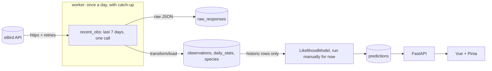

# Field Odds

**Which birds am I likely to see in my county today, and how likely is each one?**

Field Odds pulls data from the [eBird API 2.0](https://documenter.getpostman.com/view/664302/S1ENwy59) on a schedule. It archives the raw responses and runs them through a small ETL pipeline, then computes a daily likelihood for every species reported in a county. A Vue app shows the ranked list.

| Layer    | Tech |
|----------|------|
| API      | Python 3.12, FastAPI, SQLAlchemy 2, Alembic, Pydantic |
| Pipeline | Job registry plus APScheduler worker, httpx with tenacity retries |
| Model    | Seasonal detection frequency (v1), behind a swappable `LikelihoodModel` interface |
| Frontend | Vue 3, Pinia, Vue Router, TypeScript, Vite |
| Infra    | Docker Compose (Postgres 16, api, worker, nginx), GitHub Actions CI |

## Architecture



- The **worker and API are separate processes.** Jobs contain no scheduling code, so APScheduler can be swapped for Celery beat, Prefect or a cloud cron without touching them.
- **The API is for recent sightings only.** Once a day, one call fetches the last 7 days, which picks up checklists submitted late. If the machine was off or asleep, the pull runs at the next chance. A failed pull gets at most 3 attempts a day, an hour apart.
- **eBird requests share one rate limit.** A Postgres advisory lock keeps at least 1.1 seconds between requests across the worker, API and CLI.
- **Raw responses are archived** before they are transformed, so the pipeline can be replayed and new features can be built later from history.
- **Loads are idempotent.** Observations are unique on `(checklist, species)` and stats are upserted, so re-running any job is safe.
- **Every job run is recorded** in `pipeline_runs` (status, row count, error) and exposed at `/api/pipeline/runs`.

## How the likelihood is calculated (v1)

> **Being replaced.** v1 is no longer recalculated on a schedule. It will give way to a per-checklist frequency built from eBird's bulk data products. Recent sightings from the daily pull are never counted in the percentage.

eBird has no public "frequency" endpoint, so Field Odds computes its own. For a target date *D*:

1. **Sample comparable days:** *D* ± 7 days in each of the last 3 years, plus the 14 days just before *D*. The recent days count double.
2. **Keep only days with effort:** a day counts only if at least one checklist was submitted (`/product/stats`). Otherwise no one looked, which isn't the same as the bird not being there.
3. **Likelihood = weighted share of those days on which the species was reported** (`/data/obs/{region}/historic/{date}`).

Spuhs, slashes and hybrids are excluded. The logic lives in [`backend/app/ml/frequency.py`](backend/app/ml/frequency.py). The core is a pure function with unit tests.

> **What this number means:** "on comparable days, someone reported this species somewhere in the county X% of the time." That's an upper bound on what one birder at one spot will see, and it's a baseline to beat with later models.

## Quick start

```bash
# Keep the API key out of the project: add this line to ~/.zshrc, then open a new terminal
export EBIRD_API_KEY=your-key

cp .env.example .env          # optional: set REGION_CODE, TZ, etc. (no secrets needed here)
make up                       # db, api (:8000), worker, web (:8080)
make taxonomy                 # load species names (once)
open http://localhost:8080
```

Local development without Docker (uses SQLite):

```bash
make dev-api                  # FastAPI on :8000 with reload
make dev-web                  # Vite on :5173, proxies /api to :8000
cd backend && uv run python -m app.cli --help
```

API docs are at http://localhost:8000/docs.

## CLI

| Command | What it does |
|---|---|
| `python -m app.cli list-jobs` | Show registered jobs |
| `python -m app.cli run-job historic_day --day 2026-11-18` | Run one job |
| `python -m app.cli run-pipeline` | Run the scheduled job chain once |
| `python -m app.cli backfill --years 3` | Legacy v1 history fetch. Not recommended: use eBird's bulk data products for history |
| `python -m app.cli seed-taxonomy` | Load or refresh eBird taxonomy |

## Adding a new eBird call

1. Add a `Job` subclass in `backend/app/pipeline/jobs/`. Decorate it with `@register` and implement `execute(ctx, **params) -> rows`.
2. Use `ctx.client` (add an endpoint method to `EBirdClient` if needed). Call `store_raw(...)` first, then load.
3. To schedule it, add its name to `PIPELINE_JOBS` (a JSON list in `.env`, e.g. `PIPELINE_JOBS='["recent_obs","my_job"]'`).
4. Add a test with a fixture JSON under `backend/tests/fixtures/`.

## Configuration

`EBIRD_API_KEY` is read from your shell environment, both by Docker Compose and by the backend when it runs locally. You can put it in `.env` instead, which git ignores, but the shell takes priority. The key never reaches the frontend: only the backend calls eBird.

All settings are environment variables (see [`.env.example`](.env.example) and [`backend/app/config.py`](backend/app/config.py)): `EBIRD_API_KEY`, `REGION_CODE`, `TZ`, `SCHEDULE_HOUR`, `EBIRD_MIN_INTERVAL` (1.0 or higher), `DATABASE_URL`, `PIPELINE_JOBS`, `MODEL_YEARS`, `MODEL_WINDOW_DAYS`, `MODEL_RECENT_DAYS`, `MODEL_RECENT_WEIGHT`, `ENABLE_MANUAL_TRIGGERS`.

## Testing

```bash
make test      # pytest (eBird mocked with respx) + vitest
make lint      # ruff, mypy, eslint, vue-tsc
```

CI runs all of this, and also applies migrations to a real Postgres.

## Roadmap

- [ ] Species detail page and pipeline status page in the UI
- [ ] **Model v2:** gradient boosting or logistic regression on day-of-year, checklist effort and weather (Open-Meteo), evaluated against v1 with a backtest
- [ ] Checklist-level frequency from the eBird bar chart histogram, then the eBird Basic Dataset with sampling event data. Don't bulk-fetch `/product/checklist/view`: eBird's API docs say that gets you banned
- [ ] Hotspot-level predictions and a Leaflet map
- [ ] Rare-bird alerts (`/data/obs/{region}/recent/notable`)
- [ ] Multiple regions and user accounts
- [ ] Cloud deploy (Render or Fly.io) with managed Postgres

---

Bird data © [eBird](https://ebird.org), Cornell Lab of Ornithology. Use is subject to the [eBird API Terms of Use](https://www.birds.cornell.edu/home/ebird-api-terms-of-use/).
